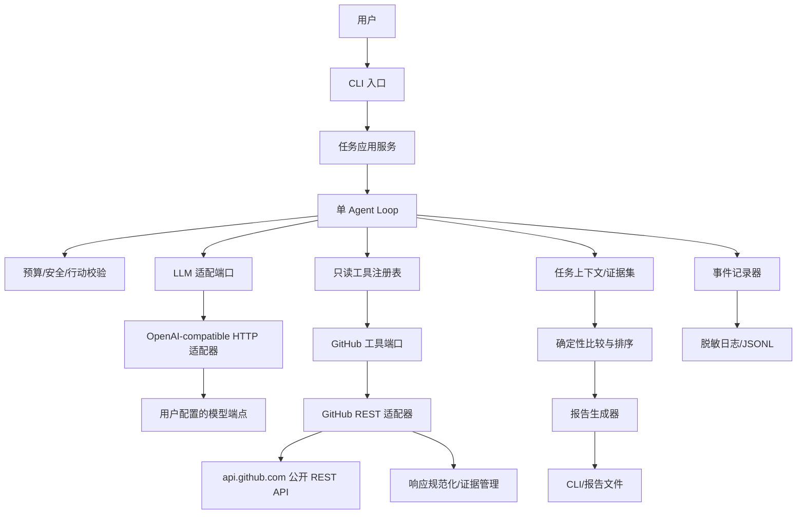
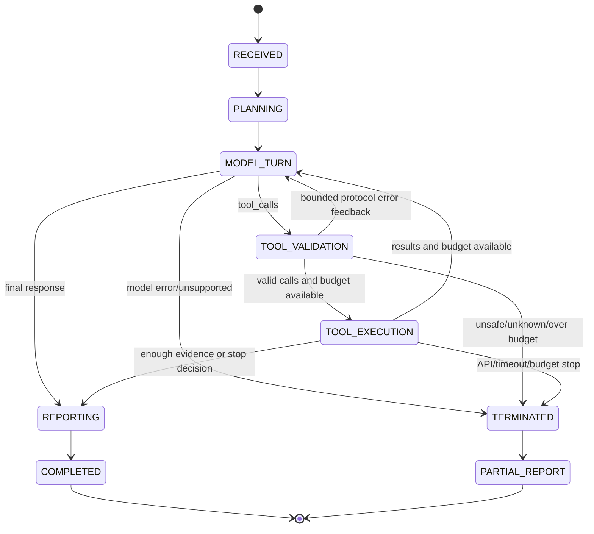

# GitHub Scout Agent 技术架构设计 V0.1

> 阶段：S2 技术架构设计
>
> 产品基线：`docs/GitHub-Scout-Agent-PRD-V0.2.md`。V0.1 产品需求分析仅用于背景和资料依据。
>
> 本文是实施前设计，不包含功能源码、依赖安装或运行结果。文中的模块名、字段名和目录名是设计建议，不是已经创建的代码接口。

## 1. 设计目标与约束

### 1.1 设计目标

架构必须支持一个轻量、可观察、可测试的公开 GitHub 研究 Agent：

- CLI 输入自然语言技术需求或公开 GitHub 仓库地址。
- 单 Agent 通过 Tool Calling 自主选择搜索、补查、改查或终止。
- GitHub 访问只读、公开、可追溯；模型不能直接访问网络。
- 事实数据、规则计算、模型解释和缺失状态分离。
- 预算、主机、参数、响应大小和权限由确定性程序强制控制。
- 不引入数据库、多 Agent、复杂编排框架或 GraphQL 前置依赖。
- Mock GitHub 和 Mock LLM 可以在没有真实 Token 或模型 Key 的情况下验证核心闭环。

### 1.2 冻结约束

本设计必须保留 PRD 的 D1–D5：

| 决策 | 架构落实 |
|---|---|
| D1 CLI | CLI 只负责输入、状态事件展示和报告输出；核心 Agent 不依赖 CLI |
| D2 双只读模式 | GitHub 客户端支持无 Token和用户自配只读 Token；固定公开 REST 主机；不提供私有或写操作 |
| D3 五类硬预算 | 预算控制器在模型调用和 GitHub 请求前后检查；模型不能修改预算 |
| D4 少量候选比较 | 内存中的有限任务上下文；少量候选、必要证据、透明排序和来源报告 |
| D5 一个 Tool Calling 端点 | 只设计一个 OpenAI-compatible 适配契约；Base URL/API Key/Model 可配置；不做多 Provider 编排 |

### 1.3 明确不做

当前架构不设计 GitHub 写 API、私有仓库、Clone、代码执行、任意 Shell、任意 URL 工具、用户文件管理、长期记忆、RAG、多 Agent、复杂数据库、Windows 桌面应用或本地 Web UI。

## 2. 总体系统架构

### 2.1 推荐分层

采用“应用编排 + 端口契约 + 受限适配器”的小型分层。端口只用于隔离真实网络和模型；不建设通用插件系统。



### 2.2 组件职责

| 组件 | 负责 | 不负责 |
|---|---|---|
| CLI | 读取用户输入、配置非秘密参数、渲染事件、显示最终报告 | 调模型、发 HTTP、执行评分或做安全判断 |
| 任务应用服务 | 创建一次任务、组装依赖、管理任务生命周期 | 解析模型内部内容或绕过预算 |
| Agent Loop | 把任务、工具定义和工具结果交给模型，依据结构化响应继续或结束 | 直接决定网络主机、HTTP 方法、预算或事实字段 |
| LLM 适配器 | 注册工具、发模型请求、解析响应、归一化 `tool_calls` | 访问 GitHub 或保存 Token 到日志 |
| 工具注册表 | 暴露固定工具名、schema 和处理函数 | 动态接收模型提供的任意工具 |
| GitHub REST 适配器 | 固定主机、GET 请求、认证头、限流/错误分类、响应解析 | 写 API、Clone、执行代码 |
| 规范化与证据管理 | 去重、字段映射、来源、抓取时间、缺失状态 | 生成事实不存在的字段 |
| 比较与排序 | 根据版本化规则计算可复现指标 | 让模型自由发明分数 |
| 报告生成器 | 将结构化事实、规则结果和模型解释组织为报告 | 从 README 猜测事实 |
| 预算与安全控制 | 在调用前后检查五类预算、主机、参数和输出限制 | 依赖 System Prompt 自觉遵守 |
| 事件与错误系统 | 记录状态、工具、耗时、错误、预算和终止原因 | 记录 Token 或完整敏感请求 |

### 2.3 核心数据流

1. CLI 创建 `ResearchTask`，任务只包含用户输入、配置引用和预算快照，不包含 GitHub Token 明文进入模型消息。
2. 应用服务把任务交给 Agent Loop，并注入固定的只读工具定义。
3. Loop 请求模型进行需求理解或下一步行动。
4. 模型返回最终文本或一个/多个 `tool_calls`。
5. 程序先检查模型响应格式、工具名、参数 schema、预算和安全边界，再决定是否执行。
6. GitHub 工具只返回规范化结构和安全错误，不把原始响应中的任意文本当作指令。
7. 工具结果写入证据集并作为受限数据消息反馈给模型；事实字段同时保留在程序上下文中。
8. 达到停止条件后，确定性排序器计算比较结果，报告生成器输出事实、证据、规则、模型解释和缺失项。

## 3. Agent Loop 与状态转换

### 3.1 状态图



### 3.2 一次模型轮次的规则

每轮只允许以下两种结果：

- **最终响应**：模型认为证据足够或无法继续；程序仍需检查报告引用和结构化事实，不能直接把模型文本当作事实数据库。
- **工具调用集合**：一个或多个已注册工具调用。程序按模型返回顺序逐个处理，默认串行执行，不开并发，以便准确计数并降低 GitHub 次级限流风险。

对于工具调用集合：

1. 验证调用 ID 存在且唯一。
2. 验证工具名属于固定注册表。
3. 解析 JSON 参数；失败时记录协议错误，不执行任何网络请求。
4. 对参数执行 Pydantic schema 校验和业务边界校验。
5. 每个真实 HTTP 请求前检查 API 请求预算、总时限和主机策略。
6. 执行工具并记录工具事件；结果只包括规范化数据或安全错误对象。
7. 将原始 assistant tool-call 消息和每个带 `tool_call_id` 的 tool 结果一起返回模型，避免破坏调用关联。
8. 如果预算耗尽，停止后续工具和模型调用，进入部分报告；不让模型再次请求“继续”。

OpenAI Chat Completions 文档定义了 `tool_calls`、`tool_call_id`、函数工具 schema 和 `tool_choice`；本设计采用这一狭窄交集，但实施时仍需用 D5 的实际端点重新验证兼容性。[OpenAI Chat Completions API Reference](https://platform.openai.com/docs/api-reference/chat/object)

### 3.3 伪代码

```text
run(task):
    context = create_context(task)
    emit(RECEIVED)

    while not context.is_terminal:
        budget.check_before_model_call()
        emit(MODEL_TURN_STARTED)
        response = llm.complete(messages=context.messages,
                                tools=tool_registry.definitions())
        budget.record_model_call(response)

        parsed = llm.parse_response(response)
        if parsed.is_final:
            context.final_text = parsed.text
            break

        calls = validate_tool_calls(parsed.calls, tool_registry, policy)
        if calls.protocol_error:
            context.add_protocol_error(calls.error)
            if context.protocol_retries_exhausted:
                terminate(PROTOCOL_ERROR)
            else:
                context.add_safe_tool_error_message(calls.error)
            continue

        for call in calls.in_order:
            budget.check_before_github_request()
            result = tool_registry.execute(call)
            budget.record_github_requests(result.request_count)
            context.add_evidence_or_error(result)
            emit(TOOL_FINISHED, redacted_summary(result))

            if budget.exhausted or result.fatal:
                terminate(reason=result.stop_reason)
                break

        if context.should_report:
            break

        context.add_results_for_next_model_turn()

    report = report_builder.build(context, deterministic_rank(context.evidence))
    emit(REPORT_READY or PARTIAL_REPORT)
    return report
```

### 3.4 为什么这是反馈驱动 Agent

行为差异来自上一轮真实工具结果，而不是固定计数：

- 空搜索结果可让模型提出更宽或不同同义词查询，也可在预算内说明无法继续。
- 候选存在但 README/许可证缺失时，模型可选择补查或把候选标为证据不足。
- `archived=true`、`incomplete_results=true`、403/429 和超时分别进入不同的程序状态和报告状态。
- 证据达到最低集合后，模型可以结束；预算耗尽则程序强制结束，即使模型继续要求工具。

固定“搜索一次、抓五个仓库、套模板”无法满足这些分支，因此不属于本设计。

## 4. Tool Calling 与最小工具接口

### 4.1 工具注册原则

注册表只包含五个产品层工具。每个工具有固定名称、JSON Schema、输入校验器、处理函数和可测试错误映射。模型不能创建新工具、改变工具权限或直接传入完整 URL。

### 4.2 `search_public_repositories`

**输入（概念 schema）**

| 字段 | 规则 |
|---|---|
| `query` | 非空字符串；限制长度和控制字符；由模型提出但由程序规范化；不得包含 API URL |
| `sort` | 允许列表，如 best match/stars/updated 等；实施前按 GitHub 当前文档校验 |
| `order` | 仅 `asc`/`desc`；与 sort 组合校验 |
| `page` | 正整数；不得超过任务分页预算 |
| `per_page` | 正整数；受产品安全上限和 GitHub 当前接口上限共同约束 |

**输出**

- `items[]`：规范化仓库候选，至少含 `full_name`、`html_url`、描述、语言线索、Stars/Forks、时间字段、`archived`、`disabled`、`fork`、许可证线索、Topics（若有）。
- `total_count`、`incomplete_results`、查询原文、排序、页码、返回数量、响应时间和来源 API URL。
- 每个 item 带 `source_kind=github_api` 和抓取时间。

**错误**：查询校验失败、限流、网络超时、JSON 格式错误、GitHub 422/5xx 等映射为统一错误码，不把失败变成空结果。

**API 依赖**：`GET /search/repositories`。

### 4.3 `get_public_repository`

**输入**：`owner`、`repo`。每项只允许 GitHub repository path 字符，拒绝斜杠外路径、控制字符、完整 URL 和 `.git` 外的任意后缀。

**输出**：仓库标准元数据、来源 URL、HTTP 状态、抓取时间和字段缺失集合。响应中的 `private=true`、`visibility` 非 public、`disabled=true` 或异常身份必须被程序拒绝或标警示，不能交给模型自行决定是否越界。

**API 依赖**：`GET /repos/{owner}/{repo}`。

**错误**：404 表示未找到或不可访问的资源；对于 MVP 不尝试用其他凭据探测私有仓库。

### 4.4 `get_public_readme`

**输入**：`owner`、`repo`，可选受限 `ref`。不接受 `download_url` 或任意 raw URL。

**输出**：README 文本的截断版本、原始大小、是否截断、SHA（若返回）、仓库 HTML/Contents 来源 URL、抓取时间和 `content_status`。README 内容始终标记为 `untrusted_remote_text`，只作为证据，不作为指令。

**大小控制**：请求前后均检查响应大小；超过上限时不把完整内容加载进模型上下文，只保留安全摘要/截断标记。具体字节阈值在 S3 资源测试后确定。

**API 依赖**：`GET /repos/{owner}/{repo}/readme` 或等价的 Contents README 只读端点。404/422 作为证据缺失或接口错误区分处理。

### 4.5 `get_repository_license`

**输入**：`owner`、`repo`。

**输出**：GitHub 识别到的许可证 key/name/SPDX/来源 URL；未识别时显式 `status=unknown`，不从 README 或模型常识推断许可证。

**API 依赖**：`GET /repos/{owner}/{repo}/license`，并可使用仓库详情中已有的 license 字段减少重复请求；是否复用由确定性请求去重逻辑决定。

**错误**：404/无匹配许可证不是程序崩溃；报告“GitHub 未识别/信息缺失”。

### 4.6 `get_repository_languages_and_topics`

**输入**：`owner`、`repo`。

**输出**：语言名称到字节数的映射、Topics 列表、各自来源 URL 和抓取时间。语言字节数只能作为语言构成参考；Topics 可能缺失或过时。

**API 依赖**：`GET /repos/{owner}/{repo}/languages` 与 `GET /repos/{owner}/{repo}/topics`。这是一个产品层组合工具，内部可以产生两次真实 GET 请求，必须按两次请求计入 API 预算。

### 4.7 工具 Mock 方法

工具层不能依赖真实网络。测试替换 HTTPX transport 或 GitHub client port，按请求 method/path/query 返回固定 JSON、状态码、headers 或异常：

- 200 正常仓库、README、许可证、语言、Topics。
- 404 README/许可证缺失。
- 403/429 带 `retry-after` 或限流 headers。
- 422 搜索参数错误。
- 超时、连接错误、非 JSON 和超大 body。
- 断言所有请求是 GET、API host 正确、请求计数准确、Token 不出现在事件和模型消息。

HTTPX 官方提供 `MockTransport`，可用 handler 根据请求返回预设响应，适合本项目的无网络工具测试。[HTTPX Transports / MockTransport](https://www.python-httpx.org/advanced/transports/)

## 5. GitHub REST 适配设计

### 5.1 双认证模式

| 模式 | 凭据来源 | 行为 |
|---|---|---|
| 无 Token | 无 GitHub Authorization header | 只访问公开接口；出现限流时停止或等待，不探测私有资源 |
| 只读 Token | 环境变量、隐藏输入或后续 OS 凭据存储 | 只加到 GitHub HTTP 客户端；不进入 LLM client、消息、报告或普通日志 |

不提供 `--token` 命令行参数，避免 Token 出现在 shell history、进程参数或 CLI 事件中。Base URL 不由模型提供；GitHub API base URL 固定为官方公开 API 主机。模型的自定义 Base URL 仅用于 D5 的 LLM 适配器，且由用户配置。

### 5.2 主机、路径和方法白名单

- GitHub host 固定为 `api.github.com`，scheme 固定 HTTPS。
- 只拼接经过 `owner/repo` 字符校验的路径片段。
- 只暴露本设计的 GET 端点；适配器没有通用 `request(method, url)` 工具。
- 禁止跟随到非 GitHub 主机的重定向；raw/download URL 不作为输入。
- API 版本 header、User-Agent 和 Accept header 由适配器统一注入，版本值在实施前按官方文档核验。

### 5.3 超时、限流和重试

HTTP client 使用明确的连接、读取、写入和池超时；任何请求不允许无限等待。HTTPX 默认会对网络不活动执行超时，适配器仍应显式设置项目级 timeout。[HTTPX Timeouts](https://www.python-httpx.org/advanced/timeouts/)

错误策略：

| 类别 | 典型状态 | 处理 |
|---|---|---|
| 输入/查询无效 | 422 | 不重试；把校验错误反馈给 Agent 或用户 |
| 未授权/权限 | 401、部分 403 | Token 无效或权限不足时停止相关分支，不泄露响应细节 |
| 限流 | 403/429 + headers/message | 读取 `retry-after`/`x-ratelimit-reset`；在任务时限和重试上限内等待，否则终止 |
| 不存在/缺失 | 404 | 区分仓库不可得、README 缺失、许可证未识别，按证据状态处理 |
| 网络瞬态 | connect/read timeout、连接错误 | 有界重试；每次重试计入事件，不能无限重试 |
| 服务端异常 | 5xx | 有界退避重试，达到上限转为可解释失败 |
| 响应异常 | 非 JSON、schema 不符、超大内容 | 不把异常响应送入模型；记录脱敏错误并终止该工具 |

搜索和 API 的当前限额可能变化，具体数字不写进产品恒量；实现时依据响应 headers 和官方文档动态处理。[GitHub REST rate limits](https://docs.github.com/en/rest/using-the-rest-api/rate-limits-for-the-rest-api) · [GitHub REST best practices](https://docs.github.com/en/rest/using-the-rest-api/best-practices-for-using-the-rest-api)

### 5.4 分页与不完整结果

搜索工具每次调用只执行一个受限页。Agent 可根据 `total_count`、返回数和 `incomplete_results` 决定是否继续，但页数和 API 请求数受预算约束。适配器保存：原始查询、sort/order、page/per_page、返回数、`incomplete_results`、抓取时间和来源 URL。

不得把达到 GitHub 搜索范围上限、只取少量页面或 incomplete 结果写成“全库检索”。

### 5.5 字段规范化

规范化层保留两个层次：

- `raw_source_ref`：endpoint、HTTP 状态、抓取时间、响应字段路径和必要的响应 hash/sha。
- `normalized_value`：报告和评分使用的稳定字段。

例如 `license=null` 变为 `{status: "unknown", value: null}`，不是 `{value: "none"}`；`pushed_at` 保留时间戳，维护状态只作为规则解释，不直接写成事实。

## 6. 模型 API 适配设计

### 6.1 推荐方案：窄 Chat Completions 兼容契约

MVP 不依赖完整 OpenAI SDK，也不建设多 Provider 框架。使用 HTTPX 通过一个小型适配器发送符合目标端点实际要求的 JSON：

- 用户配置 `Base URL`、`Model`、API Key。
- 由适配器拼接固定的 chat completions 路径策略；具体路径在 D5 端点验证时确认。
- 请求包含受控 messages、固定工具定义和受限 tool choice。
- 响应只解析有限交集：assistant message、content、`tool_calls`、finish reason、usage（若有）、错误。
- 适配器不将 GitHub Token 或原始 README 注入非必要字段。

选择直接 HTTPX 而不是先绑定官方 SDK，原因是：D5 明确要求 OpenAI-compatible 且允许自定义 Base URL，不同端点的工具调用和错误行为未必完全一致；直接 HTTP 层更容易做契约测试、脱敏和 `MockTransport`。若后续明确某端点完全兼容且 SDK 实际减少维护成本，再单独评估替换。

### 6.2 工具定义

工具定义由程序静态生成：

```text
{
  "type": "function",
  "function": {
    "name": "search_public_repositories",
    "description": "Search public GitHub repositories with bounded filters",
    "parameters": { "type": "object", "properties": {}, "required": [] },
    "strict": true
  }
}
```

实际 schema 来自参数模型，不接受模型返回的新 schema。`strict` 是否被目标端点支持需要在 D5 端点测试中确认；不支持时程序仍必须本地严格校验，而不是降低安全边界。

### 6.3 响应解析与多工具调用

- `tool_calls` 缺失且有可用 content：候选最终响应，进入报告前做引用/结构检查。
- `tool_calls` 存在：保存原 assistant message，逐个校验并执行，随后为每个调用返回带对应 `tool_call_id` 的 tool message。
- 未知工具：不执行；记录 `unknown_tool`，在预算允许时以安全协议错误反馈一次，否则终止。
- 参数 JSON 无法解析：不执行；反馈 `invalid_tool_arguments`，最多进行有限协议重试。
- 参数 schema 不合格：不执行；反馈字段错误，不把原始异常堆栈放进模型消息。
- finish reason、usage 或错误字段缺失：按端点能力记录，不把缺失误判为成功。
- 模型持续返回相同无效调用：使用重复行动检测和协议重试上限终止。

### 6.4 不支持 Tool Calling

首版直接失败并提示“当前 Model/端点不满足 Tool Calling 运行要求”。不解析自然语言中的 `run_tool(...)`、URL、Shell 命令或 JSON 伪指令。这样保持 D5 的可测试性和安全边界，避免把模型文本变成隐式执行语言。

### 6.5 Mock LLM

Mock LLM 实现固定的“对话脚本”：

- turn 1：返回搜索工具调用；
- 根据注入的空结果/缺失许可证/归档候选返回不同的补查或改查调用；
- 返回最终文本；
- 返回多工具调用、未知工具、非法 JSON、重复调用、超时和无 Tool Calling 响应。

测试验证的是 Loop 的状态转换、预算和安全控制，不是模型的真实智能。真实端点验收只在 S5、得到明确授权和配置后执行。

## 7. 数据模型与证据链

以下是必要的概念对象。字段名可在实现时微调，但事实与解释必须保持分离。

### 7.1 `ResearchTask`

```text
task_id
user_input
input_kind: natural_language | repository_url
normalized_goal
constraints
requested_candidate_limit
started_at / ended_at
model_endpoint_id_without_secret
budget_snapshot
state / termination_reason
```

不保存 Token 明文；`model_endpoint_id` 只保存可识别但不含 key 的配置标识。

### 7.2 `SearchAttempt`

```text
attempt_id
query
sort / order / page / per_page
returned_count / total_count
incomplete_results
requested_at / completed_at
source_url
status: success | empty | incomplete | error
error_ref
```

### 7.3 `RepositoryRecord`

```text
repository_id: full_name + stable API id when available
full_name / html_url
description
owner / default_branch
is_public / is_fork / is_archived / is_disabled
stargazers_count / forks_count
created_at / updated_at / pushed_at
license_evidence
topics_evidence
languages_evidence
readme_evidence
missing_fields[]
source_refs[]
```

每个可报告字段有 `source_ref` 或明确缺失状态。`RepositoryRecord` 不包含模型写入的自由事实字段。

### 7.4 `EvidenceItem`

```text
evidence_id
repository_id
kind: api_field | readme_excerpt | derived_metric | model_summary
value_or_excerpt
source_url
source_field_path
captured_at
is_truncated
trust_label: api_fact | repository_claim | deterministic_derivation | model_interpretation
```

模型摘要只能引用已有 `api_fact`、`repository_claim` 或 `deterministic_derivation`；模型不能把 `model_interpretation` 反写成事实。

### 7.5 `ToolEvent` 与 `BudgetState`

```text
ToolEvent:
  event_id / task_id / sequence
  tool_name / call_id
  input_summary_redacted
  started_at / ended_at / duration
  request_count
  outcome: success | missing | retryable_error | fatal_error | blocked
  status_code / error_code
  result_summary_redacted

BudgetState:
  model_calls_used / model_calls_limit
  github_requests_used / github_requests_limit
  elapsed_ms / elapsed_limit
  response_bytes_used / response_bytes_limit
  candidates_seen / candidates_limit
  exhausted_dimensions[]
```

预算状态由程序创建并更新；模型消息只能看到有限的非秘密剩余状态，不能写回预算上限。

### 7.6 `RecommendationReport`

```text
report_id / task_id / generated_at
goal_summary
search_history[]
candidates[]
comparison_rows[]
recommendations[]
missing_and_uncertain[]
termination
source_index[]
rule_version
```

候选和推荐对象包含事实引用、规则结果和解释引用；不允许只有一段无来源的自然语言结论。

## 8. 比较、排序与报告生成

### 8.1 两阶段决策

**第一阶段：确定性硬性过滤。**

- 不是公开仓库、身份无法验证或来源不完整的候选不得进入推荐。
- 归档、禁用、Fork、缺许可证等不是统一自动淘汰条件；除非用户约束要求，否则作为风险/未知标记。
- 超出候选预算时按已定义的稳定顺序截断，不让模型临时扩大范围。

**第二阶段：确定性排序。**

建议维度：

- 需求匹配证据：搜索词、Topics、描述和 README 中与目标的可见匹配。
- 证据完整度：元数据、README、许可证、语言和来源是否齐全。
- 维护相关信号：`pushed_at` 等时间线线索，使用限定语。
- 采用信号：Stars/Forks 作为弱信号，不可单独决定推荐。
- 风险标记：归档、禁用、缺许可证、结果不完整和截断内容。

具体权重不在 S2 冻结。每次报告保存 `rule_version`、输入字段和缺失处理方式。

### 8.2 缺失值规则

- Unknown 与 0 不等价。
- “未识别许可证”不会自动变成 0 分或“无许可证”；影响由规则说明决定。
- 截断 README 不可获得“完整 README 证据”标记。
- 任何排序都同时显示证据完整度和风险项，避免单一总分掩盖未知。

### 8.3 报告生成顺序

1. 程序生成事实表和来源索引。
2. 程序生成比较字段和规则结果。
3. 模型根据受限结构化上下文生成摘要、取舍解释和限制说明。
4. 程序校验模型文本中的候选 URL、仓库身份和关键字段是否存在于证据集。
5. 校验失败时报告进入“需要人工复核/生成失败”，不静默接受虚构。
6. CLI 输出报告；可选地在当前项目目录保存 Markdown/JSON，不写外部目录。

## 9. 安全及预算控制

### 9.1 安全控制链

```text
模型提议
  → 工具名白名单
  → JSON/schema 校验
  → owner/repo/query 业务校验
  → GitHub host/path/method 白名单
  → 预算检查
  → GET 请求
  → 响应大小/状态/schema 校验
  → 数据标签与脱敏
  → 证据集/安全 tool result
```

每一层都可独立测试；安全性不依赖提示词、模型拒答或用户善意。

### 9.2 README Prompt Injection

- README 内容被包装为 `untrusted_remote_text`，进入数据字段，不进入系统/开发者指令。
- 反馈模型时明确内容是待分析数据；只允许生成摘要、风险或证据引用。
- 不执行 README 命令，不把其中的 URL 直接交给网络工具，不允许其修改工具定义或预算。
- 对 README 做字节大小限制、截断标志和内容摘要；不把截断文本描述为全文。

### 9.3 Token 和日志脱敏

- GitHub Token 和 LLM API Key 只在各自 HTTP client 的内存配置中使用。
- 禁止进入任务对象、模型 messages、tool result、报告、异常、事件输入和版本控制。
- 日志过滤 `Authorization`、API key 字段、查询参数中的敏感值；错误只保留错误码和脱敏摘要。
- CLI 参数不接收秘密；使用环境变量、隐藏输入或后续 OS 凭据存储。

### 9.4 五类硬预算

预算控制器是 Loop 的不可绕过依赖：

| 预算 | 检查点 | 违反时 |
|---|---|---|
| 模型调用轮次 | 每次模型请求前 | 不再请求模型，进入部分报告 |
| GitHub API 请求数 | 每次真实 GET 前 | 不执行请求，记录 `budget_blocked` |
| 总执行时间 | 每次模型/API/重试前 | 取消后续工作并标记超时 |
| 单次返回内容大小 | 读取 body 前和交给模型前 | 拒绝、截断或标记不完整 |
| 最大候选数量 | 收集候选和补查前 | 截断候选或停止扩展 |

所有重试、分页和组合工具的内部请求都计数。预算阈值在 S3/S4 通过资源测量后确定，不在此文硬编码。

## 10. 错误处理与可观测性

### 10.1 错误对象

错误统一为：

```text
error_code
category: input | protocol | auth | permission | not_found | rate_limit |
          timeout | network | upstream | schema | budget | safety
retryable: true/false
user_message
safe_model_message
source_status
attempt_count
```

模型只收到 `safe_model_message` 和下一步允许的状态；完整堆栈只供本地诊断且必须脱敏。

### 10.2 事件类型

至少记录：`task_started`、`model_call_started`、`model_call_finished`、`tool_call_validated`、`tool_started`、`tool_finished`、`budget_updated`、`retry_scheduled`、`state_changed`、`report_ready`、`task_terminated`。

每个事件包含 task ID、序号、时间、状态和脱敏摘要。日志可以写 stderr，并可选择写当前项目目录下的 JSONL；不把日志输出到用户未授权路径。

### 10.3 诊断要点

- API 错误：看 `ToolEvent`、状态码、headers 中的限流信息和请求计数。
- 模型工具错误：看原始响应的脱敏结构、工具 schema、协议重试次数和端点配置标识。
- 虚构字段：看报告字段校验失败、EvidenceItem source refs 和模型输出校验结果。
- 无限循环：看重复 call signature、budget state 和 state transition 序列。
- 空结果：看 SearchAttempt 查询、分页和 `incomplete_results`，不只看最终报告。

## 11. 技术栈与项目目录建议

### 11.1 推荐技术栈

| 领域 | 推荐 | 选择理由 | 备注 |
|---|---|---|---|
| Python | Python 3.11 作为 MVP 基线 | 有现代类型语法和标准库 `tomllib`；成熟、易在 Windows 验证 | S3 先检查本机解释器；不在 S2 安装 |
| CLI | Typer | 基于类型提示，适合少量命令和参数，能快速生成帮助信息 | 不引入 Web 框架；输出先用标准流 |
| HTTP | HTTPX 同步 Client | 明确 timeout、Client 生命周期和 MockTransport；Agent Loop 默认串行 | 暂不使用异步并发 |
| 模型 API | HTTPX + 自研窄适配器 | 适配自定义 Base URL 和兼容差异，便于 Mock 与脱敏 | 不提前绑定完整 SDK |
| 外部数据校验 | Pydantic v2 | 输入校验、序列化和 JSON Schema 可作为工具定义来源 | 版本在 S3 依赖验证时确定 |
| 内部简单对象 | Pydantic 或标准库 dataclass | 不为每个小对象创建额外层；外部边界优先 Pydantic | 由实施时保持一致 |
| 测试 | pytest | fixtures、参数化和 monkeypatch 适合分层测试 | 真实 API/模型测试默认显式选择 |
| 日志 | 标准库 `logging` + 结构化事件格式 | 少依赖、可脱敏、可写 stderr/JSONL | 不强制 structlog |
| 配置 | `pyproject.toml` + 环境变量/隐藏输入 | 非秘密配置可文件化，秘密不落盘 | `tomllib` 只读；不自动写配置 |
| 打包 | `pyproject.toml` + setuptools build backend | 成熟且简单；支持可编辑安装和 CLI entry point | S3 再验证构建工具版本 |

Typer 官方定位为基于 Python 类型提示的 CLI 工具；Pydantic 官方文档支持基于类型提示的验证和 JSON Schema；pytest 提供 fixtures/monkeypatch；Python 3.11 起标准库提供 `tomllib`。[Typer](https://typer.tiangolo.com/) · [Pydantic validation](https://pydantic.dev/docs/validation/latest/get-started/) · [pytest monkeypatch](https://docs.pytest.org/en/stable/how-to/monkeypatch.html) · [Python tomllib](https://docs.python.org/3.11/library/tomllib.html)

### 11.2 依赖数量控制

MVP 基线依赖只包含 CLI、HTTP、数据校验和测试所需组件。暂不引入 LangChain、CrewAI、LangGraph、数据库、向量库、ORM、Web 框架、重型观测平台或多 Provider SDK。类型检查、lint 和 Rich 风格输出可作为后续质量增强，不构成当前架构前置依赖。

### 11.3 建议目录

```text
github-scout-agent/
├─ docs/
├─ src/
│  └─ github_scout_agent/
│     ├─ cli.py                 # CLI 入口和参数/输出适配
│     ├─ application/
│     │  ├─ service.py          # 一次任务的组装与生命周期
│     │  └─ agent_loop.py       # 单 Agent Loop 与状态转换
│     ├─ domain/
│     │  ├─ models.py           # 任务、仓库、证据、报告、预算对象
│     │  ├─ scoring.py          # 确定性比较与规则版本
│     │  └─ errors.py           # 领域错误和终止原因
│     ├─ ports/
│     │  ├─ llm.py              # LLM 适配契约
│     │  └─ github.py           # GitHub 工具/只读契约
│     ├─ adapters/
│     │  ├─ llm_openai_compatible.py
│     │  └─ github_rest.py
│     ├─ policy/
│     │  ├─ budget.py           # 五类硬预算
│     │  └─ security.py         # 主机、路径、工具、内容和脱敏规则
│     ├─ reporting/
│     │  └─ builder.py          # 事实+规则+模型解释的报告组装
│     └─ observability/
│        ├─ events.py            # 事件 schema
│        └─ logging.py           # 脱敏 logger
├─ tests/
│  ├─ unit/
│  ├─ github_mock/
│  ├─ llm_mock/
│  ├─ integration/
│  └─ fixtures/
├─ pyproject.toml
└─ README.md
```

这个结构保留了端口/适配器隔离，但没有拆成几十个微型模块。CLI、Agent、GitHub、LLM、预算、安全、报告和日志职责可独立测试。

## 12. 测试架构和验收映射

### A. 纯单元测试

**目标**：无需网络、Token 或模型。

覆盖：

- owner/repo/公开 GitHub URL 解析和拒绝越界路径。
- 工具参数 schema、query 长度、分页、sort/order 和错误参数。
- HTTP status/headers 到领域错误的映射。
- 字段规范化、缺失值、`archived`、license unknown、README 截断标记。
- 去重、稳定排序、规则版本和 Unknown 不等于 0。
- 五类预算的前置阻断、累计请求计数、重试计数和终止原因。
- Tool-call JSON 解析、未知工具、重复 call ID、非法参数、重复行动检测。
- Token/Authorization/Key/README 敏感字段脱敏。
- 报告 source ref 校验和模型输出中的仓库 URL 反向验证。

**映射**：FR-01、FR-05、FR-07、FR-10、FR-11、FR-12；S-02、S-03、S-04、S-05、S-06、S-07。

### B. Mock GitHub API 测试

**目标**：验证 REST 适配器和工具集合，不访问网络。

使用 HTTPX `MockTransport` 根据 method/path/query 返回夹具。

关键用例：

| 输入 | 预期行为 | 定位依据 |
|---|---|---|
| 正常搜索 JSON | 得到候选、来源、分页和 incomplete 字段 | SearchAttempt/RepositoryRecord |
| 404 README | 候选保留，README evidence 为 missing，不是任务成功空文本 | ToolEvent + EvidenceItem |
| 404 license | license status=unknown，报告不猜许可证 | License evidence |
| 403/429 + retry headers | 有界退避/终止；不快速重复请求 | error_code/rate headers |
| 422 查询错误 | 不重试，反馈可修正输入错误 | error category input |
| 超时/5xx | 有界重试，达到上限后终止该工具 | retry events |
| 非 JSON/超大 body | 拒绝或截断；不送模型 | schema/size policy |
| 任意非 GitHub URL | 在请求前拒绝，Mock transport 不应收到请求 | host policy |

**映射**：FR-02、FR-03、FR-04、FR-06、FR-10、FR-11、FR-12；F-01、F-02、F-06；S-01、S-02、S-05、S-07。

### C. Mock LLM / Tool Calling 测试

**目标**：验证真实 Agent Loop，不依赖供应商。

脚本化模型返回：

1. 搜索调用 → 少量结果 → 补查 README/许可证 → 最终报告。
2. 空结果 → 改写 query；第二次仍空 → 有依据终止。
3. 归档仓库 → 保留状态并在报告中标风险。
4. 缺许可证 → 补查后仍未知 → 输出 unknown。
5. 多个 tool calls → 串行执行且每个结果带正确 call ID。
6. 未知工具/非法 JSON/非法参数 → 不执行网络，最多协议重试后终止。
7. 已耗尽预算 → 模型请求继续，但程序阻断并生成部分报告。

**映射**：FR-01、FR-05、FR-06、FR-07、FR-08、FR-09、FR-11、FR-12；F-03、F-04、F-05、F-07、F-08；S-03、S-04、S-06。

### D. 真实 GitHub 只读 API 集成测试

**条件**：获得单独授权、可用网络和无 Token/只读 Token 任一测试凭据；不执行任何写请求。

- 使用少量明确的公开仓库样本，运行前记录 URL、日期、API 版本头和测试目的。
- 覆盖搜索、单仓库、README、license、languages/topics、404/归档/缺失字段和限流响应处理。
- 断言 method 只为 GET、host 为官方公开 API、没有 Clone 或外部网络请求。
- 记录真实响应字段、状态和当前环境；不把动态结果写为永久基线。
- Token 测试后检查报告、日志和模型消息快照不含 Token。

**映射**：F-01、F-02、F-06；S-01、S-02、S-05、S-07。该层只验证 GitHub 适配，不证明模型推荐质量。

### E. 真实模型 Agent 闭环验收

**条件**：D5 的一个实际支持 Tool Calling 的端点、用户明确授权、明确成本/调用上限和可用 API Key。当前 S2 不执行。

- 验证工具 schema 注册、工具调用返回、多个 tool calls、错误响应和 finish reason。
- 使用固定需求集，至少覆盖“结果不足改查”“缺证据补查”“归档标注”“预算终止”。
- 检查模型不能生成未经工具响应支持的候选或字段。
- 保存脱敏事件和报告；记录模型/端点、输入、轮次、请求数、失败和覆盖盲点。
- 对不支持 Tool Calling 的端点验证明确失败，不进入文本命令降级。

**映射**：F-01、F-03、F-05、F-07、F-08、S-03、S-04、S-05。

### 12.1 验收证据规则

Mock 通过只证明程序分支和安全边界。真实 API 通过只证明当前公开 API 交互和字段处理。真实模型通过只证明一个端点在给定输入/环境下的 Tool Calling 闭环。三者不能互相替代，也不能将文档检查标记为功能通过。

## 13. S3–S5 实施依赖

本节仅规划执行顺序，不授权本轮开发。

### S3：受限闭环原型

**先决条件**：用户明确授权开发；S2 设计评审通过。

**范围**：项目骨架、领域对象、工具注册表、Mock LLM、Mock GitHub、Agent Loop、五类预算、事件日志、脱敏和离线测试。

**不依赖**：真实 GitHub Token、真实模型 API、真实仓库网络调用。

**出口条件**：A/B/C 类测试覆盖主要分支；F-03/F-07/F-08、S-03/S-04/S-06 在 Mock 下有真实测试结果。

### S4：GitHub REST 只读适配

**依赖**：S3 Loop、工具端口、预算和事件 schema 稳定。

**范围**：REST 适配器、双认证、host/path/method 白名单、超时/限流/分页/字段映射、README 大小限制和真实公开 API 集成测试。

**不依赖**：多 Provider、GraphQL、私有仓库或 GitHub 写权限。

**出口条件**：D 类测试有真实日志；F-01/F-02/F-06、S-01/S-02/S-05/S-07 完成对应覆盖声明。

### S5：真实模型闭环与 MVP 验收

**依赖**：S3 Mock 闭环和 S4 GitHub 适配均通过；用户另行授权真实模型 API 和费用。

**范围**：D5 端点验证、CLI 可观测输出、报告引用校验、真实模型 E 类测试、预算阈值实测和回归测试。

**出口条件**：F/S 全部有对应证据；未覆盖能力、动态 API 限制、模型差异和成本风险写入验收记录。

## 14. 技术风险、取舍和待验证事项

### 14.1 已做取舍

| 取舍 | 推荐 | 放弃/后置理由 |
|---|---|---|
| REST vs GraphQL | REST | MVP 端点直接、工具易 Mock、边界较小；GraphQL 限制和查询复杂度暂不值得引入 |
| 同步 vs 异步 | 同步串行 | 任务规模小、限流安全和调试优先；后续若有实测并发需求再评估 |
| 自研 Loop vs Agent 框架 | 自研轻量 Loop | 学习目标是理解核心机制；避免框架隐式扩大工具/状态/重试行为 |
| HTTPX vs 专用 SDK | HTTPX + 窄适配器 | 自定义 Base URL 和兼容端点差异更可控；MockTransport 直接支持 |
| 内存上下文 vs 数据库 | 内存 + 报告文件 | MVP 单任务、少量候选；数据库会提前引入持久化、安全和迁移成本 |
| Typer vs argparse | Typer | CLI 参数少但需要类型化和可读帮助；若 S3 环境兼容性不足，可退回 argparse |
| Pydantic vs 全部 dataclass | Pydantic 边界优先 | 外部 JSON/schema 校验价值明确；内部小对象不再额外引入抽象 |

### 14.2 实施前必须验证

1. 本机 Python 3.11 和 Windows CLI 打包/编码行为。
2. Typer、HTTPX、Pydantic、pytest 的兼容版本和锁定方式。
3. 目标 OpenAI-compatible 端点的实际请求路径、工具 schema、`tool_calls`、多个工具调用、错误结构、finish reason、超时和 usage 字段。
4. GitHub 当前 API version header、搜索参数、分页上限、README media type、限流 headers 和公开端点认证行为。
5. README 实际响应大小与截断阈值，避免把短摘要误认为全文证据。
6. 预算阈值：模型轮次、GitHub 请求数、总时长、单次响应大小和候选数。
7. Windows 上 Token 的安全输入/环境变量/可选凭据存储方案。
8. 报告 Markdown/JSON 输出在项目目录内的编码和脱敏行为。

### 14.3 主要残余风险

- 不同 OpenAI-compatible 端点对工具调用的兼容程度可能不同；D5 只保证一个端点先验收。
- GitHub 字段和限流策略会变化；需要响应头和官方文档驱动，而不是固定当前数字。
- README 与描述可能含 Prompt Injection 或误导性自述；隔离和来源标签必须在程序层测试。
- Stars、Forks 和 push 时间是弱信号；透明排序仍不等于项目质量证明。
- 模型可能生成超出证据的解释；报告引用校验和事实/解释分离是必要的最后一道门。
- 当前目录不是 Git 仓库，尚无提交级回滚锚点；S3 初始化时必须先建立安全的版本控制和变更保护流程，但本轮不初始化。

## 15. S2 设计检查结论

- **覆盖 PRD P0**：FR-01–FR-12 均在架构、工具、数据、报告、预算或测试映射中有对应设计。
- **真实 Agent Loop**：状态图、伪代码和空结果/缺证据/归档/限流/预算分支明确依赖工具反馈，不是固定步骤脚本。
- **程序强制安全**：工具白名单、固定 GitHub host、GET-only、schema 校验、大小限制、预算和脱敏均不依赖模型提示词。
- **独立 Mock**：GitHub 使用 HTTPX MockTransport；LLM 使用脚本化 Tool Calling；排序、预算、报告和安全可纯单测。
- **真实性**：RepositoryRecord、EvidenceItem、source refs、缺失状态和报告反向校验覆盖仓库及字段来源。
- **复杂度控制**：单 Agent、同步 HTTP、五个工具、无数据库、无框架编排、无 GraphQL；端口/适配器仅保留必要隔离。
- **D1–D5**：全部保留，没有把 Web UI、桌面应用、私有仓库、多 Provider 或伪 Tool Calling 混入 MVP。
- **S3 阻碍**：存在实施前验证项，但没有架构级阻碍；S3 仍必须等待用户明确授权，且当前不执行。

**S2 结论：架构设计达到待审阅状态；本轮不进入 S3，不创建源码，不安装依赖，不调用模型或真实 GitHub API。**

## 参考资料

- [GitHub REST search API](https://docs.github.com/en/rest/search/search?apiVersion=2022-11-28)
- [GitHub REST repositories API](https://docs.github.com/en/rest/repos/repos?apiVersion=2022-11-28)
- [GitHub REST contents/README API](https://docs.github.com/en/rest/repos/contents?apiVersion=2022-11-28)
- [GitHub REST rate limits](https://docs.github.com/en/rest/using-the-rest-api/rate-limits-for-the-rest-api)
- [GitHub REST best practices](https://docs.github.com/en/rest/using-the-rest-api/best-practices-for-using-the-rest-api)
- [OpenAI Chat Completions API reference](https://platform.openai.com/docs/api-reference/chat/object)
- [Typer official documentation](https://typer.tiangolo.com/)
- [HTTPX timeouts](https://www.python-httpx.org/advanced/timeouts/)
- [HTTPX transports and MockTransport](https://www.python-httpx.org/advanced/transports/)
- [Pydantic validation and JSON Schema](https://pydantic.dev/docs/validation/latest/get-started/)
- [pytest monkeypatch](https://docs.pytest.org/en/stable/how-to/monkeypatch.html)
- [Python 3.11 `tomllib`](https://docs.python.org/3.11/library/tomllib.html)
